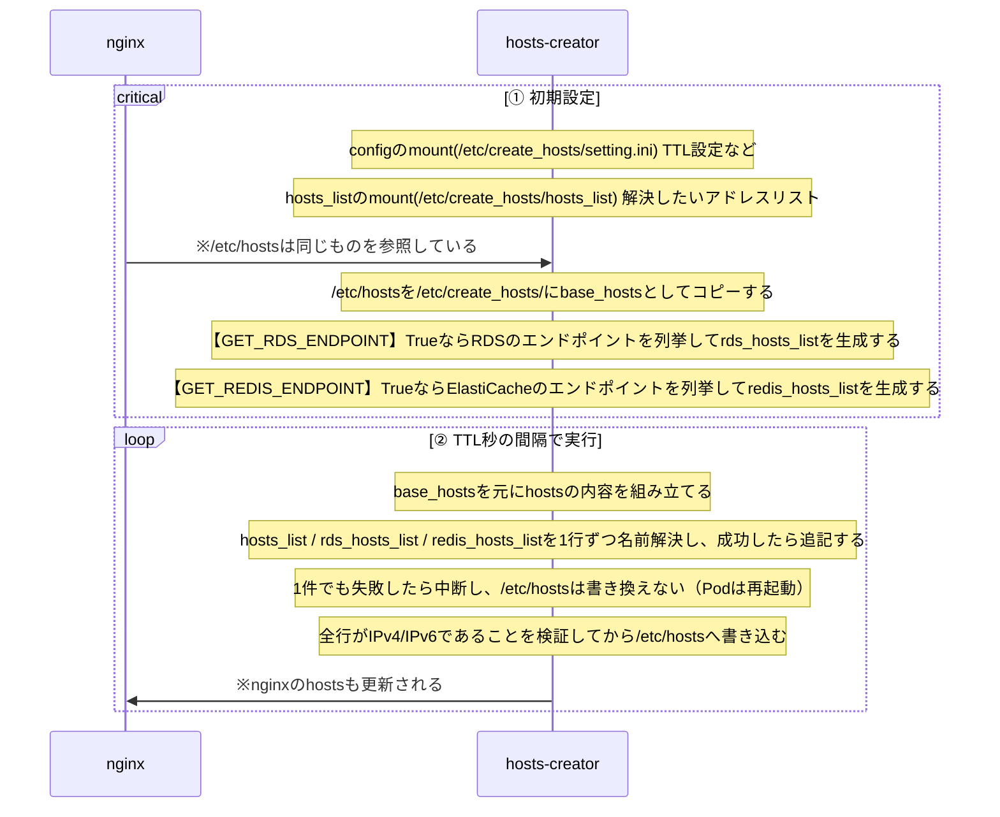

# hosts-creator

[English](README.md) | **日本語**

`hosts_list` に書いたホスト名を定期的に名前解決し、`/etc/hosts` を更新し続けるサイドカーです。
`GET_RDS_ENDPOINT` / `GET_REDIS_ENDPOINT` を有効にすると、AWS 上の RDS / ElastiCache の
エンドポイントをタグで抽出して同じように hosts に載せます。

狙いは CoreDNS の負荷を下げることではなく、**アプリの名前解決を DNS から切り離すこと**です。
答えが `/etc/hosts` に入ってしまえば、プロセスはローカルで解決し、CoreDNS が落ちても影響を受けません。



## 使い方

```bash
# 設定の検証（DNS も AWS も触らない）
docker run --rm -v "$PWD/sample/rust:/etc/create_hosts:ro" \
  rhemsjapan/hosts-creator:v0.1.0 --check-config

# 1周だけ実行して結果を確認（/etc/hosts は変更しない）
docker run --rm -v "$PWD/sample/rust:/etc/create_hosts:ro" \
  rhemsjapan/hosts-creator:v0.1.0 --once --dry-run --base-hosts /tmp/base_hosts
```

`sample/rust/` は `namespace.yml` と `configMapGenerator` 込みで自己完結しています。

```bash
kubectl apply -k sample/rust
```

`/etc/hosts` は nginx などのサイドカーと **共有ボリューム（emptyDir）経由で同じファイル**を
マウントする必要があります（別コンテナの `/etc/hosts` は別ファイルです）。
そのため本実装は `/etc/hosts` を `rename(2)` ではなく in-place で書き換えます
（subPath マウントされたファイルは rename できないため）。

## setting.ini

`example`

```ini
[DEFAULT]
TTL = 10
GET_RDS_ENDPOINT = True
GET_REDIS_ENDPOINT = True

[RDS]
CLOUD_ENV = aws
SELECT_TAG_KEY =
SELECT_TAG_VALUE =

[REDIS]
CLOUD_ENV = aws
SELECT_TAG_KEY =
SELECT_TAG_VALUE =
```

|param|description|default|Note|
|:---:|:---|:---:|:---|
|TTL|何秒間隔でhostsを書き換えるか|10|setting.ini > 環境変数(`$CREATE_HOST_TTL`)の優先順位。いずれも見つからない場合にデフォルト値を利用する|
|GET_RDS_ENDPOINT|RDSのendpointを取得するかどうか|False|`true`（大文字小文字は問わない）のみ真。それ以外はfalse扱い|
|GET_REDIS_ENDPOINT|Redisのendpointを取得するかどうか|False|〃（※`GET_RDS_ENDPOINT`と同様）|
|CLOUD_ENV|クラウドサービスの種類。現状AWSのみ実装|aws|大文字小文字は問わない。有効時に誤った文字列を指定するとPodは終了する|
|SELECT_TAG_KEY|対象リソースのタグkey名。指定しない場合は空にする|||
|SELECT_TAG_VALUE|対象リソースのタグvalue名。指定しない場合は空にする|||

タグ指定の挙動（旧 Python 版と同一。互換のため意図的に維持しています）:

|指定|RDS|Redis|
|---|---|---|
|key/value とも空|全インスタンス|全クラスタ|
|key/value とも指定|一致するものだけ|一致するものだけ|
|片方だけ指定|**0件**（設定ミスの可能性大／警告ログ出力）|**全件**（警告ログ出力）|

## 環境変数

setting.ini が無い／キーが無い場合に参照されます。

|変数|対応するキー|
|---|---|
|`CREATE_HOST_TTL`|`TTL`|
|`GET_RDS_ENDPOINT`|`GET_RDS_ENDPOINT`|
|`GET_REDIS_ENDPOINT`|`GET_REDIS_ENDPOINT`|
|`RDS_CLOUD_ENV` / `RDS_SELECT_TAG_KEY` / `RDS_SELECT_TAG_VALUE`|`[RDS]` の同名キー|
|`REDIS_CLOUD_ENV` / `REDIS_SELECT_TAG_KEY` / `REDIS_SELECT_TAG_VALUE`|`[REDIS]` の同名キー|
|`AWS_REGION` / `AWS_DEFAULT_REGION`|AWS SDK が参照（IRSA 利用時は不要）|
|`RUST_LOG`|ログレベル（既定 `info`）|

## CLI

```
hosts-creator [OPTIONS]

  --config <PATH>             setting.ini のパス           [env: SETTING_FILE]    [default: /etc/create_hosts/setting.ini]
  --hosts-path <PATH>         書き換え対象の hosts         [env: HOSTS_PATH]      [default: /etc/hosts]
  --hosts-list <PATH>         解決対象リスト               [env: HOSTS_LIST]      [default: /etc/create_hosts/hosts_list]
  --rds-hosts-list <PATH>     RDS エンドポイントの出力先    [env: RDS_HOSTS_LIST]  [default: /etc/create_hosts/rds_hosts_list]
  --redis-hosts-list <PATH>   Redis エンドポイントの出力先  [env: REDIS_HOSTS_LIST][default: /etc/create_hosts/redis_hosts_list]
  --base-hosts <PATH>         base_hosts の保存先          [env: BASE_HOSTS_FILE] [default: /etc/create_hosts/base_hosts]
  --once                      1周だけ実行して終了（CronJob・デバッグ用）
  --dry-run                   解決結果を標準出力に出し、hosts は書き換えない
  --check-config              設定の検証のみ行う（DNS も AWS も触らない）
```

終了コードは 0（正常終了）/ 1（設定不正・名前解決失敗・書き込み失敗）です。
名前解決に失敗した場合に 1 で終了するのは意図的な設計です（中途半端な `/etc/hosts` を残さない）。

## リソース

公開イメージ（`rust-latest`、arm64）を TTL 10 秒で 2 分間動かし、cgroup の `cpu.stat` と
`memory.current` / `memory.peak` を読んだ実測値です。

|項目|8 ホスト名|62 ホスト名|
|---|---:|---:|
|常駐メモリ（RSS）|7.3 MB|7.4 MB|
|CPU（1 コア比）|0.05 %|0.15 %|
|1 周あたりの処理時間|約 5 ms|約 15 ms|
|cgroup のメモリピーク|13.2 MB|14.4 MB|

キャッシュを持たない実装なので、ホスト名を増やしてもメモリはほぼ増えません。
数値は hosts-creator 本体のみで、nginx などのサイドカーは別枠です。

```yaml
resources:
  requests:
    cpu: 10m
    memory: 32Mi
  limits:
    cpu: 100m
    memory: 64Mi
```

## IAM

IAM role でやる場合（IRSA でも同じポリシー）

```json
{
    "Version": "2012-10-17",
    "Statement": [
        {
            "Sid": "VisualEditor0",
            "Effect": "Allow",
            "Action": [
                "rds:DescribeDBInstances",
                "elasticache:DescribeCacheClusters",
                "elasticache:ListTagsForResource"
            ],
            "Resource": "*"
        }
    ]
}
```

## イメージタグ

コンテナイメージは Docker Hub の [`rhemsjapan/hosts-creator`](https://hub.docker.com/r/rhemsjapan/hosts-creator)
で公開しています。

| タグ | 内容 |
|---|---|
| `v0.1.0` / `0.1.0` | 0.1.0 の固定タグ（amd64 / arm64）。本番はこれを推奨 |
| `rust-latest` | Rust 版の最新（可変タグ） |
| `latest` / `py-latest` | 2023 年版の Python 実装（凍結） |

`latest` は 2023 年版の Python 実装のまま固定しており、Rust 版へは切り替えません。
すでに多くの環境で `latest` が使われており、黙って中身が入れ替わらないようにするためです。
Rust 版は `v0.1.0` か `rust-latest` を指定してください。

## 旧 Python 版（2023）との違い

|項目|Python 版|Rust 版|
|---|---|---|
|書き込み前の検証|書き込んだ後に検証（不正なら Pod 停止、hosts は壊れたまま）|**書き込み前に検証**（不正なら旧内容を保持して停止）|
|`/etc/hosts` の書き方|内容コピー（in-place）|in-place 固定。subPath マウントでも動く|
|名前解決|逐次（dnspython）|8並列（hickory）。キャッシュ無効で鮮度は同等|
|CLI|なし|`--once` / `--dry-run` / `--check-config` / 全パス上書き|
|`CLOUD_ENV=tencent`|無言でスキップ（実際はリスト未生成で異常終了）|警告を出して空リストで継続|
|デバッグ用JSONダンプ|`describe_*_response*.json` を出力|出力しない|
|ログ書式|`[LEVEL time Lline:name]`|`[LEVEL time target]`（行番号のみ欠落）|
|SIGTERM|即死（書き込み中断の可能性）|1周の完了を待って終了|
|`base_hosts` の末尾改行なし|次行が連結されて壊れる|改行を補う|

## ビルド

```bash
# ローカル
cargo build --release          # target/release/hosts-creator
cargo test --all-targets
cargo clippy --all-targets -- -D warnings

# イメージ
docker build -t hosts-creator:rust .
```

このリポジトリはソースのみを置いています（CI/CD の定義は含みません）。

## ライセンス

MIT（[LICENSE](LICENSE)）。
