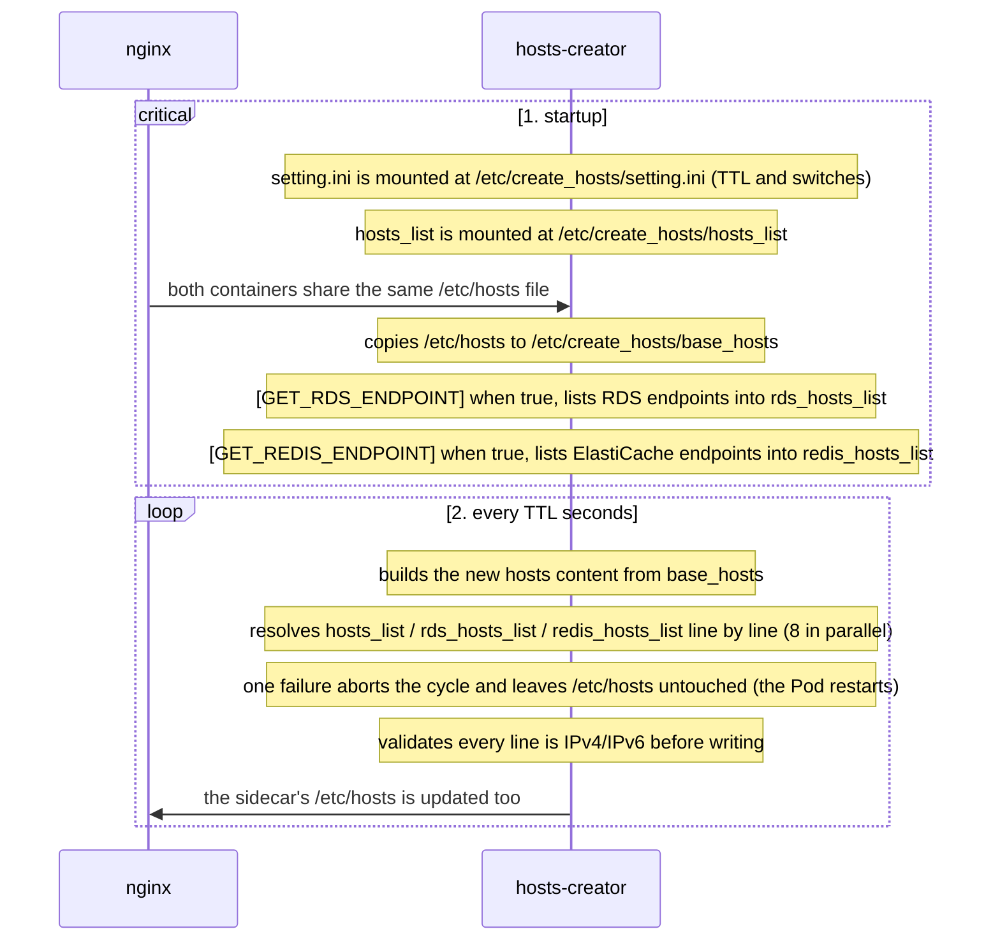

# hosts-creator

**English** | [日本語](README.ja.md)

A sidecar that keeps `/etc/hosts` up to date by resolving a list of hostnames on a fixed interval.
With `GET_RDS_ENDPOINT` / `GET_REDIS_ENDPOINT` enabled it also discovers RDS and ElastiCache endpoints
in AWS by tag and writes those into the same file.

The goal is not to lower CoreDNS load. It is to **take an application's name resolution off DNS
entirely**: once the answer is in `/etc/hosts`, the process resolves locally and a CoreDNS outage no
longer touches it.



## Quick start

```bash
# validate the configuration (no DNS, no AWS calls)
docker run --rm -v "$PWD/sample/rust:/etc/create_hosts:ro" \
  rhemsjapan/hosts-creator:v0.1.0 --check-config

# run one cycle and print the result without touching /etc/hosts
docker run --rm -v "$PWD/sample/rust:/etc/create_hosts:ro" \
  rhemsjapan/hosts-creator:v0.1.0 --once --dry-run --base-hosts /tmp/base_hosts
```

`sample/rust/` is a self-contained kustomization (namespace and `configMapGenerator` included):

```bash
kubectl apply -k sample/rust
```

## Sharing `/etc/hosts` with a sidecar

`/etc/hosts` must be the **same file** in both containers, mounted through a shared volume (emptyDir).
Another container's `/etc/hosts` is a different file, so mounting nothing gets you nothing.

For that reason the writer never uses `rename(2)`; it rewrites the file in place, which is what makes
`subPath` mounts work. `base_hosts` keeps the entries kubelet generated, so the Pod's own entry is not lost.

## setting.ini

```ini
[DEFAULT]
TTL = 10
GET_RDS_ENDPOINT = True
GET_REDIS_ENDPOINT = True

[RDS]
CLOUD_ENV = aws
SELECT_TAG_KEY =
SELECT_TAG_VALUE =

[REDIS]
CLOUD_ENV = aws
SELECT_TAG_KEY =
SELECT_TAG_VALUE =
```

| param | description | default | notes |
|:---:|:---|:---:|:---|
| `TTL` | seconds between rewrites | 10 | `setting.ini` beats env `CREATE_HOST_TTL`; the built-in default applies only when neither exists |
| `GET_RDS_ENDPOINT` | discover RDS endpoints | False | only `true` (case-insensitive) is truthy |
| `GET_REDIS_ENDPOINT` | discover ElastiCache endpoints | False | same rule |
| `CLOUD_ENV` | cloud provider, AWS only today | aws | case-insensitive; an unknown value while enabled makes the Pod exit |
| `SELECT_TAG_KEY` | tag key used to select resources | | empty means "no filter" |
| `SELECT_TAG_VALUE` | tag value used to select resources | | empty means "no filter" |

Tag matching is deliberately identical to the 2023 Python version:

| what you set | RDS | Redis |
|---|---|---|
| key and value both empty | every instance | every cluster |
| key and value both set | matches only | matches only |
| only one of them set | **nothing** (warning logged) | **everything** (warning logged) |

## Environment variables

Read when `setting.ini` or a key in it is missing.

| variable | key it maps to |
|---|---|
| `CREATE_HOST_TTL` | `TTL` |
| `GET_RDS_ENDPOINT`, `GET_REDIS_ENDPOINT` | same names |
| `RDS_CLOUD_ENV`, `RDS_SELECT_TAG_KEY`, `RDS_SELECT_TAG_VALUE` | `[RDS]` |
| `REDIS_CLOUD_ENV`, `REDIS_SELECT_TAG_KEY`, `REDIS_SELECT_TAG_VALUE` | `[REDIS]` |
| `AWS_REGION` / `AWS_DEFAULT_REGION` | read by the AWS SDK (not needed with IRSA) |
| `RUST_LOG` | log level, default `info` |

## CLI

```
hosts-creator [OPTIONS]

  --config <PATH>            setting.ini            [env: SETTING_FILE]     [default: /etc/create_hosts/setting.ini]
  --hosts-path <PATH>        file to rewrite        [env: HOSTS_PATH]       [default: /etc/hosts]
  --hosts-list <PATH>        hostnames to resolve   [env: HOSTS_LIST]       [default: /etc/create_hosts/hosts_list]
  --rds-hosts-list <PATH>    RDS endpoint output    [env: RDS_HOSTS_LIST]   [default: /etc/create_hosts/rds_hosts_list]
  --redis-hosts-list <PATH>  Redis endpoint output  [env: REDIS_HOSTS_LIST] [default: /etc/create_hosts/redis_hosts_list]
  --base-hosts <PATH>        base_hosts location    [env: BASE_HOSTS_FILE]  [default: /etc/create_hosts/base_hosts]
  --once                     run one cycle and exit (CronJob / debugging)
  --dry-run                  print the resolution result, do not write
  --check-config             validate the configuration only (no DNS, no AWS)
```

Exit codes are 0 (ok) and 1 (bad configuration, resolution failure, write failure). Exiting 1 on a
resolution failure is intentional: a partially written `/etc/hosts` is worse than a restart.

## Resource usage

Measured, not estimated: the published `rust-latest` image (arm64) running with TTL 10s for two minutes,
reading `cpu.stat` and `memory.current` / `memory.peak` from the cgroup.

| metric | 8 hostnames | 62 hostnames |
|---|---:|---:|
| resident memory (RSS) | 7.3 MB | 7.4 MB |
| CPU (share of one core) | 0.05 % | 0.15 % |
| time per cycle | ~5 ms | ~15 ms |
| cgroup memory peak | 13.2 MB | 14.4 MB |

There is no cache to fill, so more hostnames lengthen a cycle but barely move memory. The numbers cover
hosts-creator itself; sidecars such as nginx are separate.

```yaml
resources:
  requests:
    cpu: 10m
    memory: 32Mi
  limits:
    cpu: 100m
    memory: 64Mi
```

## AWS permissions

The same policy works for an IAM role on the node or for IRSA.

```json
{
  "Version": "2012-10-17",
  "Statement": [
    {
      "Sid": "VisualEditor0",
      "Effect": "Allow",
      "Action": [
        "rds:DescribeDBInstances",
        "elasticache:DescribeCacheClusters",
        "elasticache:ListTagsForResource"
      ],
      "Resource": "*"
    }
  ]
}
```

## Image tags

Images are published at [`rhemsjapan/hosts-creator`](https://hub.docker.com/r/rhemsjapan/hosts-creator).

| tag | contents |
|---|---|
| `v0.1.0` / `0.1.0` | pinned 0.1.0 (amd64 / arm64). Use this in production |
| `rust-latest` | newest Rust build (moving tag) |
| `latest` / `py-latest` | the 2023 Python implementation, frozen |

`latest` is not switched to the Rust build on purpose: it is already deployed in many places and should
not change contents silently. Pin `v0.1.0` or `rust-latest` for the Rust version.

## Differences from the 2023 Python version

| item | Python | Rust |
|---|---|---|
| validation | after writing (a bad file stays on disk) | **before writing** (old content kept, Pod stops) |
| write method | content copy (in place) | in place; works with `subPath` mounts |
| resolution | sequential (dnspython) | 8 in parallel (hickory), cache disabled |
| CLI | none | `--once` / `--dry-run` / `--check-config` / every path overridable |
| `CLOUD_ENV=tencent` | skipped silently, then failed on a missing list | warning, continues with an empty list |
| debug JSON dumps | wrote `describe_*_response*.json` | not written |
| log format | `[LEVEL time line:name]` | `[LEVEL time target]` |
| SIGTERM | exits immediately (may interrupt a write) | finishes the current cycle first |
| `base_hosts` without a trailing newline | next entry got concatenated | newline is added |

## Build

```bash
cargo build --release          # target/release/hosts-creator
cargo test --all-targets
cargo clippy --all-targets -- -D warnings
docker build -t hosts-creator:rust .
```

This repository holds source only; no CI/CD definitions. Images are published from elsewhere.

## License

MIT ([LICENSE](LICENSE)).
